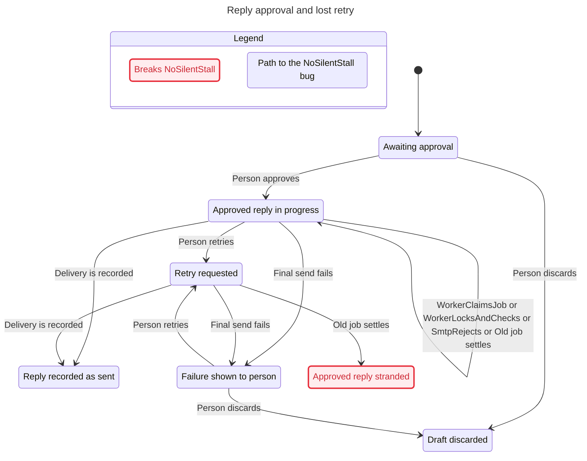

# Verification evidence

Reconfirmed against 38c9ab9fc2b4 on 2026-11-12 after the #184 conversation rename. No product source changes are retained.

## Results

`pnpm verify:send-reply` checks four invariants in six scenarios. The expected failures remain failures, and all four mutant checks violate their intended invariant. Four unchanged-model controls must pass under the exact same constants and faults as their paired mutants. Each mutant disables person retries. The ordinary model explores 246 states without injected faults and 1,378 with lease expiry. These are bounded model results, not a proof about arbitrary workers or retries.

The real integration replay passes four cases using Postgres, pg-boss and Mailpit. A successful SMTP call followed by an injected exception produces two accepted copies on retry, or one accepted copy with `send_failed` after retry rejection. An injected give-up transaction failure leaves `approved`. Pausing after the give-up transaction commit allows a retry to reuse the active job, which subsequently fails and leaves `approved`.

The transport exception exercises rollback after acceptance. It does not physically kill a worker or fail the COMMIT network request. Worker death and expiry remain modeled scenarios supported by the pg-boss source mapping, not live crash replays.

## Shortest paths

Duplicate delivery (#130): approve; claim; lock and check; SMTP accepts; transaction rolls back; pg-boss settles for retry; claim; lock and check; SMTP accepts again.

Hidden delivery (#130): approve; claim; lock and check; SMTP accepts; transaction rolls back; retry rejects; give-up commits `send_failed`; pg-boss marks the job failed. The customer already has the reply.

Lost retry: approve; first send rejects; retry rejects; give-up commits `send_failed`; a person retries and commits `approved`, reusing the active job; pg-boss marks that job failed.

Generated by `/statechart`: seven chart states and eleven arrows. The view merges internal steps that leave the visible outcome unchanged; 171 such steps are omitted from the chart. The numbered report retains all eleven transitions of the lost-retry counterexample.

## Real-code mutation proof

`pnpm verify:send-reply:mutations` runs four integration assertions unchanged against normal and temporarily broken source. All four pass before and after mutation. During mutation:

| Source change                                                              | Assertion that fails    | Observed failure                                                       |
| -------------------------------------------------------------------------- | ----------------------- | ---------------------------------------------------------------------- |
| Remove `handleSendGaveUp`'s call to `markSendFailed`                       | `NoSilentStall`         | Expected `send_failed`, got `approved`                                 |
| Let `draftTransitions.markSendFailed` accept `sent`                        | `NoHiddenDelivery`      | Expected `sent`, got `send_failed`                                     |
| Admit `sent` in `handleSendReply` and move SMTP before its database writes | `NoResendWithoutPerson` | Expected one transport acceptance, got two                             |
| Same send mutation                                                         | `SentOnlyWhenApproved`  | Second transport call observes committed status `sent`, not `approved` |

The tests use real Postgres and the real lifecycle/send functions. The stall check runs a real pg-boss worker through its final failed attempt and drains settlement before asserting the visible failure. Their recording transport counts accepted calls; the separate Mailpit replay demonstrates the corresponding external delivery behavior. The second send is counted even when the later unique-message constraint rejects its transaction. Source patches, original bytes and assertion logs are saved in `.helpos/send-mutations/`. The matching TLA+ mutants violate the same properties. No product edits remain.

## Statechart review

All 24 scenario/invariant results were successfully processed with the installed pstack `/statechart` skill in a Linux container, using the unchanged TLC 1.7.4 jar. This avoids the Windows launcher and output-parser failures without changing pstack or copying its commands into the generated skill. Model mutant results were reviewed the same way.

The shortest #130 duplicate-delivery path has nine transitions; hidden delivery after commit failure has eleven. The lost-retry path has eleven. Worker death strands an approved draft in eight; give-up transaction failure does so in ten. These match the code ordering and the integration replays where exercised. Worker death remains a modeled, source-mapped case rather than a live process-kill test.

`/deslop` and `/no-comments` review corrected the model's merged transaction/job-settlement actions, missing registration coverage and CRLF-sensitive coverage parsing. #184 merged; the tests and coverage record now use conversation names. The covered changes rename identifiers and preserve the modeled event order. `pnpm verify` and `pnpm verify:send-reply` are the final handoff checks; successful model-runner exit still includes the known findings.

## Independent review follow-up

The review demonstrated that setting `MarkSendFailedFrom == {}` in the base model still returned success because the resulting stall was accepted as the existing lost-retry finding. The runner now checks the unchanged model and each mutant under identical conditions, requiring a pass before the mutant failure counts as evidence. The same scratch break now exits 1 with `control give-up-does-nothing already breaks NoSilentStall without mutation`.

`node --test .claude/skills/verify-send-reply/scripts/check.test.mjs` runs the real checker in an isolated fixture, verifies all four passing controls, applies that base-model break and requires rejection. It is included in `pnpm test:scripts` and explicitly skips when Java is absent. The controls cover these mutation scenarios; they do not make known-failure allowances distinguish all possible regressions. Continue reviewing their traces when the model changes.

The four new controls also passed `/statechart` review in Linux. Verification now checks 24 scenario/invariant results, four passing controls and four failing mutants. `pnpm verify` and all 81 tests in `pnpm test:scripts` passed after this change.
