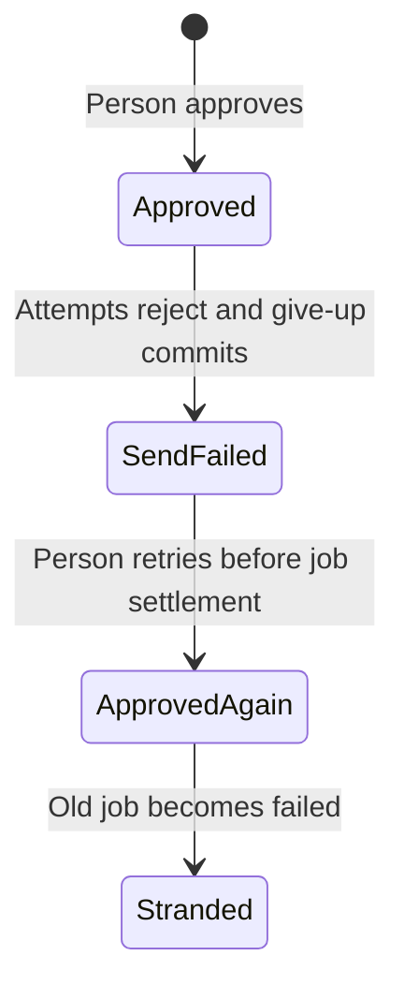

# Verification evidence

Checked against 801b81e15e31 on 2026-11-12. No product source changes are retained.

## Results

`pnpm verify:send-reply` checks four invariants in six scenarios. The expected failures remain failures, and all four mutant checks violate their intended invariant. Each mutant disables person retries. The ordinary model explores 246 states without injected faults and 1,378 with lease expiry. These are bounded model results, not a proof about arbitrary workers or retries.

The real integration replay passes four cases using Postgres, pg-boss and Mailpit. A successful SMTP call followed by an injected exception produces two accepted copies on retry, or one accepted copy with `send_failed` after retry rejection. An injected give-up transaction failure leaves `approved`. Pausing after the give-up transaction commit allows a retry to reuse the active job, which subsequently fails and leaves `approved`.

The transport exception exercises rollback after acceptance. It does not physically kill a worker or fail the COMMIT network request. Worker death and expiry remain modeled scenarios supported by the pg-boss source mapping, not live crash replays.

## Shortest paths

Duplicate delivery (#130): approve; claim; lock and check; SMTP accepts; transaction rolls back; pg-boss settles for retry; claim; lock and check; SMTP accepts again.

Hidden delivery (#130): approve; claim; lock and check; SMTP accepts; transaction rolls back; retry rejects; give-up commits `send_failed`; pg-boss marks the job failed. The customer already has the reply.

Lost retry: approve; first send rejects; retry rejects; give-up commits `send_failed`; a person retries and commits `approved`, reusing the active job; pg-boss marks that job failed.

This hand-written chart shows only the lost-retry path. It is not a generated statechart report.

## Scratch checks and remaining handoff gates

Removing the give-up call, allowing give-up to overwrite `sent`, and removing the initial row lock in real source each made the command reject the changed coverage fingerprint. All edits were restored, and the final command returned to its expected-findings baseline. Separately, model mutants demonstrate violations of all four invariants. Source drift detection plus model mutations is not an executable source-to-model equivalence proof. In particular the complete send-outside-transaction source refactor has not been replayed. The issue's requirement to demonstrate every property on a broken variant of the real code remains open.

The pstack `/statechart` launcher failed on Windows with `spawn /bin/sh ENOENT`. Invoking its worker directly generated reports for passing invariants, but failed on violations with `TLC exited 12 ... output names no rule that broke`. Raw TLC outputs correctly identify the invariants and shortest paths. A successful `/statechart` review of those failures remains open; do not mark this PR ready on the strength of runner exit 0.

`/deslop` and `/no-comments` review removed redundant model banners and runner narration. The review also found and corrected merged transaction/job-settlement actions, missing registration coverage and CRLF-sensitive coverage parsing. No product fix was made. #184 was still open at the last check, so coverage uses the current ticket names.
