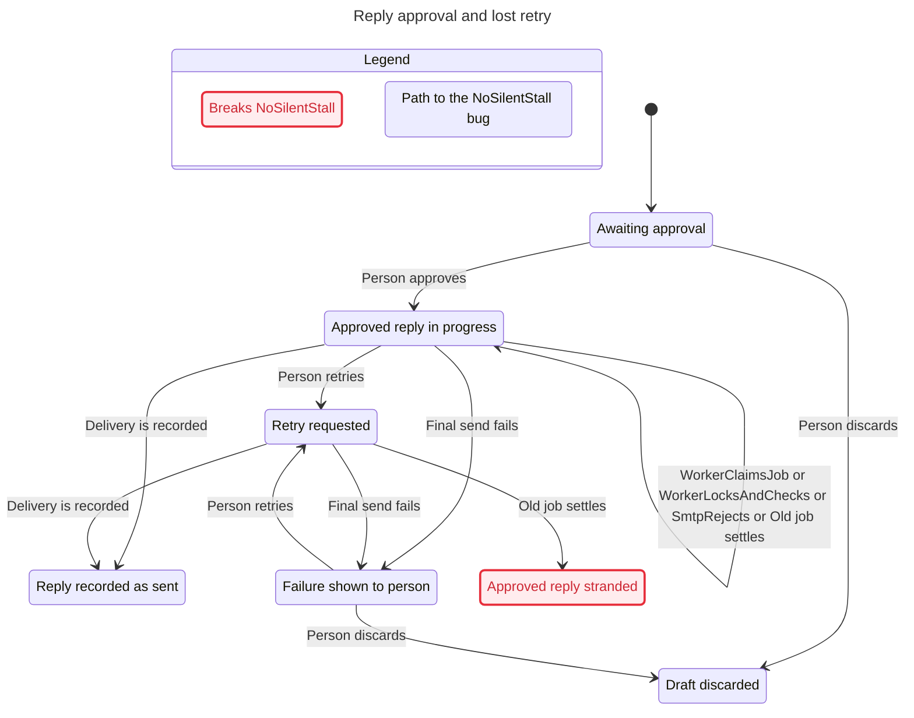

## Audit input review for issue 85

`change` now locks and reads the draft before its existing conditional update.
That keeps an edit's old body hash tied to the row being edited, including when
two edits race. The update still checks the same transition statuses and optional
body or resend guard. A conflict returns that locked row without auditing it.
`changeDetails` derives body hashes, discard reasons, retry reasons and status
transitions from that operation. `recordAudit` validates them before insertion.
An invalid event throws inside the caller's transaction and rolls back its writes.

Review compared `change`, `changeDetails`, approval, retry, discard, sending,
rejection, uncertainty resolution, sent and failed-send updates with their mapped
actions. The extra read acquires the row lock earlier within the same transaction.
It creates no new commit boundary. Approval still guards the exact reviewed body
and queues the same job after its audit. Retry retains its approved requeue and
singleton key. Explicit resend keeps its new Message-ID and singleton generation.
The rejection path for an explicit resend keeps `send_uncertain` and now records
that unchanged status truthfully. Normal rejection still restores `approved`.

The worker's preparation commit, second-transaction marker recheck, SMTP call,
final commit and pg-boss settlement stay separate. `PersonApproves`,
`PersonRetriesSend`, `PersonDiscards`, `PersonResolvesSent`, `PersonResolvesResend`,
`WorkerLocksAndChecks`, `SmtpRejects`, `TransactionCommits` and `GiveUpMarksFailed`
retain their existing guards and committed effects. Audit validation failures are
transaction failures already covered by rollback and give-up failure behavior.
The model does not represent audit contents. No model action, invariant, bound or
known-finding allowance changes. The new details helper joins fingerprint coverage.
Lost retry and failed give-up remain known `NoSilentStall` findings.

## Conversation write ownership review for issue 240

The extraction onto the pinned #193 parent keeps the same SQL, await order, caller transactions, clocks, guards and audit events. `handleSendReply` still commits the prepared outbound message with `sentAt: null` and `markSending` before SMTP. Its second transaction locks and rechecks the same marker, calls SMTP, then confirms the message, marks the draft sent and updates conversation activity. Definite rejection still changes the draft before removing the prepared message. An explicit resend rejection retains the original uncertainty.

`resolveUncertainSend` still locks the draft and validates status, Message-ID and sent-message identity before confirming the message and activity, then recording `draft.send_confirmed`. The resend branch is unchanged. `addMessage`, `markMessageSent`, `recordActivity` and `removeRejectedMessage` now own the extracted statements, so their bodies join the coverage record. The corrected declaration selector from #193 remains in use, and the scratch checker fixture copies the new module.

No model action, invariant, bound or known-finding allowance changes. `WorkerLocksAndChecks`, `SmtpRejects`, `TransactionCommits` and `PersonResolvesSent` describe the same committed effects. Audit writes stay where they were relative to those effects. The pre-refresh run reproduced the expected model results and rejected only the changed worker and resolution fingerprints. Source mutations and the final runner results are recorded in the issue 240 decision trail. Lost retry and failed give-up still break `NoSilentStall`; this refactor does not fix them.

# Issue 130 verification

## Issue 193 actor boundary

Lifecycle mutations now receive an `AuditContext` containing the actor, tenant and
request ID. They record their audit events from that context in the same transaction.
The shared actor definition and built-in actor registry preserve stored identities.

Semantic review compared `change`, approval, retry, discard, uncertainty resolution,
the send worker and give-up with their mapped model actions. The context replaces
the bound audit closure. Status predicates, conditional updates, row locks, Message-ID
generation, queue keys and enqueue order are unchanged. Preparation still commits
the uncertainty marker before SMTP. The second transaction rechecks its message
identity before sending. SMTP acceptance, the final database commit and pg-boss
settlement remain separate. The model does not include audit identity, so no action,
guard, promise or known finding changes.

The first focused replay run exposed an observation race in the existing
`NoHiddenDelivery` test. It observed the committed uncertainty marker and immediately
read zero Mailpit copies, although SMTP had not yet accepted the reply. The repair
uses the existing bounded polling helper to wait for one actual copy before the
unchanged exact-count assertion. It adds no retries or longer deadline. The original
COMMIT-failure, rejection, physical-crash and settlement checks remain intact.

New integration cases exercise nested lifecycle audit attribution for user, agent
and built-in actors, and prove a mismatched audit tenant rolls back the draft write.
The send mutation runner targets the new give-up call signature. The separate
lost-retry and give-up failures remain known `NoSilentStall` findings.

The earlier coverage selector recursively chose the first matching declaration or
property. For `markSending`, `rejectSend`, `markSent` and `markSendFailed`, that was
the same-named `draftTransitions` entry, not the function. Earlier hashes therefore
did not protect those four function bodies. This limits the earlier fingerprint
evidence; it does not invalidate the runtime assertions or source mutation results.
The selector now prefers a function declaration in the current lexical scope before
searching nested properties. A regression mutates every covered function body in a
scratch copy, requires its fingerprint to change, then restores and checks the hash.
It also covers nested `createJobRunner.consume` and `createJobRunner.work`.
The original selector fails this regression. All four previously missed functions
were inspected against their mapped model actions before reconfirmation.

## Issue 213 composer extraction

The outbound composer now owns MIME construction, reply headers, notice headers and
Message-ID formatting. Approval and explicit resend still allocate a UUID in their
original transaction. The composer only formats that value with the original domain
and prefix. Automatic retries still reuse the stored Message-ID.

Semantic review compared `PersonApproves`, `PersonResolvesResend`,
`WorkerLocksAndChecks`, `PreparationFails` and `WorkerRechecksMarker` with the
extraction. MIME compilation still completes before the marker commit. SMTP, its
second transaction, the attempt identity check, status guards and settlement have
not moved. No model action or promise changes. Fingerprints also cover the extracted
formatter and compiler. The real-code send-before-validation mutant now targets
the renamed compiler call and must still fail both safety assertions.

Five exact-byte fixtures in `fixtures/email/outbound/composer.json` were captured
from the original builders at the pinned #195 base before moving code. JSON escapes
preserve the original mixture of CRLF and LF bytes. The existing shadow reply and
draft notice fixtures remain unchanged. The fixture test has no update mode.

The separate lost-retry and give-up failures remain known `NoSilentStall` findings.
An expected model-runner exit does not mean every promise holds.

## Existing send protocol

The send worker commits an outbound message and `send_uncertain` before SMTP. Its second transaction locks the draft and checks the message identity again. Only the worker that still owns that marker can send. A retry leaves uncertainty visible without calling SMTP. A human decision must match the current Message-ID and pass the session, scope and tenant checks.

The model maps the first committed transaction to `WorkerLocksAndChecks`, and the second lock and identity check to `WorkerRechecksMarker`. SMTP acceptance, final commit and queue settlement remain separate actions. `PreparationFails` leaves the previous committed state unchanged. A rejected explicit resend keeps the original uncertainty visible. The model represents a new Message-ID as a new person-retry generation.

Fresh focused verification passes 53 tests against Postgres, pg-boss and Mailpit, including a physical child-process kill after SMTP acceptance and a database COMMIT failure. Recovery never adds an automatic second copy. The laptop and phone Playwright suites pass 11 tests, including both human recovery choices and normal failed-send recovery.

The six model scenarios preserve `NoResendWithoutPerson`, `NoHiddenDelivery` and `SentOnlyWhenApproved`. `NoSilentStall` still has the separate lost-retry and give-up findings. All six unchanged-model controls hold, and all six mutant/property pairs break their intended promise. Fingerprints were confirmed only after comparing the covered lifecycle, worker and registration code with those actions.

The preserved statechart receipts are under `E:/Projects/helpdesk/.helpos/autopilot/130-statechart-review/`. The current model has the same operators as those receipts. The lost-retry path is approval, failed preparation, retry, failed preparation, give-up, person retry, then old-job settlement. Worker death before preparation on the last attempt can still strand approval. A failed give-up can do the same. The real integration tests retain the lost-retry and give-up reproductions.

Limits remain one draft, two workers, one automatic retry and one person retry. The model abstracts preparation and does not model HTTP permissions, tenant isolation, shadow routing or arbitrary job generations. Integration and browser tests cover those separately. An expected model-runner exit is not a claim that every invariant holds.

## Historical evidence before issue 130

The following records preserve the earlier findings and proofs. They describe the old send protocol, not the current implementation.

Reconfirmed against 38c9ab9fc2b4 on 2026-11-12 after the #184 conversation rename. No product source changes are retained.

## Dead system-job removal (#198)

Reconfirmed against `2326ebf7a048`. `consume` narrows its payload type and removes a cast. `work` removes the unused system-job branch and its casts. The tenant handler, transaction boundaries, last-attempt check, give-up transaction and error propagation remain unchanged. The model needs no action or invariant changes. All 24 scenario results, four passing controls and four failing mutants matched the existing expectations. The known delivery and stall findings below remain open.

## Results

`pnpm verify:send-reply` checks four invariants in six scenarios. The expected failures remain failures, and all four mutant checks violate their intended invariant. Four unchanged-model controls must pass under the exact same constants and faults as their paired mutants. Each mutant disables person retries. The ordinary model explores 246 states without injected faults and 1,378 with lease expiry. These are bounded model results, not a proof about arbitrary workers or retries.

The real integration replay passes four cases using Postgres, pg-boss and Mailpit. A successful SMTP call followed by an injected exception produces two accepted copies on retry, or one accepted copy with `send_failed` after retry rejection. An injected give-up transaction failure leaves `approved`. Pausing after the give-up transaction commit allows a retry to reuse the active job, which subsequently fails and leaves `approved`.

The transport exception exercises rollback after acceptance. It does not physically kill a worker or fail the COMMIT network request. Worker death and expiry remain modeled scenarios supported by the pg-boss source mapping, not live crash replays.

## Shortest paths

Duplicate delivery (#130): approve; claim; lock and check; SMTP accepts; transaction rolls back; pg-boss settles for retry; claim; lock and check; SMTP accepts again.

Hidden delivery (#130): approve; claim; lock and check; SMTP accepts; transaction rolls back; retry rejects; give-up commits `send_failed`; pg-boss marks the job failed. The customer already has the reply.

Lost retry: approve; first send rejects; retry rejects; give-up commits `send_failed`; a person retries and commits `approved`, reusing the active job; pg-boss marks that job failed.

Generated by `/statechart`: seven chart states and eleven arrows. The view merges internal steps that leave the visible outcome unchanged; 171 such steps are omitted from the chart. The numbered report retains all eleven transitions of the lost-retry counterexample.

## Real-code mutation proof

`pnpm verify:send-reply:mutations` runs four integration assertions unchanged against normal and temporarily broken source. All four pass before and after mutation. During mutation:

| Source change                                                              | Assertion that fails    | Observed failure                                                       |
| -------------------------------------------------------------------------- | ----------------------- | ---------------------------------------------------------------------- |
| Remove `handleSendGaveUp`'s call to `markSendFailed`                       | `NoSilentStall`         | Expected `send_failed`, got `approved`                                 |
| Let `draftTransitions.markSendFailed` accept `sent`                        | `NoHiddenDelivery`      | Expected `sent`, got `send_failed`                                     |
| Admit `sent` in `handleSendReply` and move SMTP before its database writes | `NoResendWithoutPerson` | Expected one transport acceptance, got two                             |
| Same send mutation                                                         | `SentOnlyWhenApproved`  | Second transport call observes committed status `sent`, not `approved` |

The tests use real Postgres and the real lifecycle/send functions. The stall check runs a real pg-boss worker through its final failed attempt and drains settlement before asserting the visible failure. Their recording transport counts accepted calls; the separate Mailpit replay demonstrates the corresponding external delivery behavior. The second send is counted even when the later unique-message constraint rejects its transaction. Source patches, original bytes and assertion logs are saved in `.helpos/send-mutations/`. The matching TLA+ mutants violate the same properties. No product edits remain.

## Statechart review

All 24 scenario/invariant results were successfully processed with the installed pstack `/statechart` skill in a Linux container, using the unchanged TLC 1.7.4 jar. This avoids the Windows launcher and output-parser failures without changing pstack or copying its commands into the generated skill. Model mutant results were reviewed the same way.

The shortest #130 duplicate-delivery path has nine transitions; hidden delivery after commit failure has eleven. The lost-retry path has eleven. Worker death strands an approved draft in eight; give-up transaction failure does so in ten. These match the code ordering and the integration replays where exercised. Worker death remains a modeled, source-mapped case rather than a live process-kill test.

`/deslop` and `/no-comments` review corrected the model's merged transaction/job-settlement actions, missing registration coverage and CRLF-sensitive coverage parsing. #184 merged; the tests and coverage record now use conversation names. The covered changes rename identifiers and preserve the modeled event order. `pnpm verify` and `pnpm verify:send-reply` are the final handoff checks; successful model-runner exit still includes the known findings.

## Independent review follow-up

The review demonstrated that setting `MarkSendFailedFrom == {}` in the base model still returned success because the resulting stall was accepted as the existing lost-retry finding. The runner now checks the unchanged model and each mutant under identical conditions, requiring a pass before the mutant failure counts as evidence. The same scratch break now exits 1 with `control give-up-does-nothing already breaks NoSilentStall without mutation`.

`node --test .claude/skills/verify-send-reply/scripts/check.test.mjs` runs the real checker in an isolated fixture, verifies all four passing controls, applies that base-model break and requires rejection. It is included in `pnpm test:scripts` and explicitly skips when Java is absent. The controls cover these mutation scenarios; they do not make known-failure allowances distinguish all possible regressions. Continue reviewing their traces when the model changes.

The four new controls also passed `/statechart` review in Linux. Verification now checks 24 scenario/invariant results, four passing controls and four failing mutants. `pnpm verify` and all 81 tests in `pnpm test:scripts` passed after this change.

## Busy-budget retry allowance (#203)

AI steps handlers can return a delayed continuation. The job runner, which owns pg-boss retry metadata, carries `retryLimit - retryCount` into its successor. Busy work consumes no failure allowance, and previously failed calls cannot regain retries. The successor uses the queue's retry delay and backoff from its own first failure; this change preserves the cumulative failure count, not the old job's backoff position.

The send-model actions remain unchanged: transactional send handlers return no deferral, errors still reach pg-boss after the transaction rejects, and give-up still runs only when retryCount reaches retryLimit. The additional return path applies to AI steps jobs outside this bounded send model. The defineJob return wrapper and consume/work fingerprints change; no promises or known findings are removed. This source branch retains the earlier send implementation; integration must carry these runner changes into the separately verified #130/#195/#213 stack and recheck that combined result.

A real production-registry/Postgres/pg-boss regression alternates two provider failures, a busy deferral, one more failure, another deferral, then the fourth failure. It asserts remaining limits of one and zero on successors, exactly four model calls, one give-up, and draft_failed. The old implementation fails because the first successor has retry_limit=3 instead of 1. The existing 31-deferral recovery and ingestion recovery tests still pass. Queue eligibility is accelerated in the test database; real claims, settlements and handler results remain in use.

## Stored payload boundary

The #335 assembly preserves the valid-payload path through `consume`: the handler receives the same remaining failure allowance, give-up still runs after handler rollback on the last failure, and pg-boss settles the rethrown error. Invalid payloads instead throw a fixed error before either typed callback. Only the final invalid attempt reports queue and job ID. No payload, validation detail or tenant identifier is passed to the error hook.

Only the `createJobRunner.consume` coverage fingerprint changes from `1c5921f6eb32` to `23141a4a4b69`. `work`, `defineJob`, enqueue SQL, send operations, policy constants, the model, mutants and checker remain unchanged from the assembled prerequisites. The 36 frozen model outcomes remain inherited evidence under their original valid-payload assumptions. They do not prove malformed-job behavior. The source real pg-boss and composed-server regressions are retained for that proof. Fresh combined runtime execution requires the coordinator's bounded Postgres grant. Known lost-retry and give-up `NoSilentStall` findings remain open.
