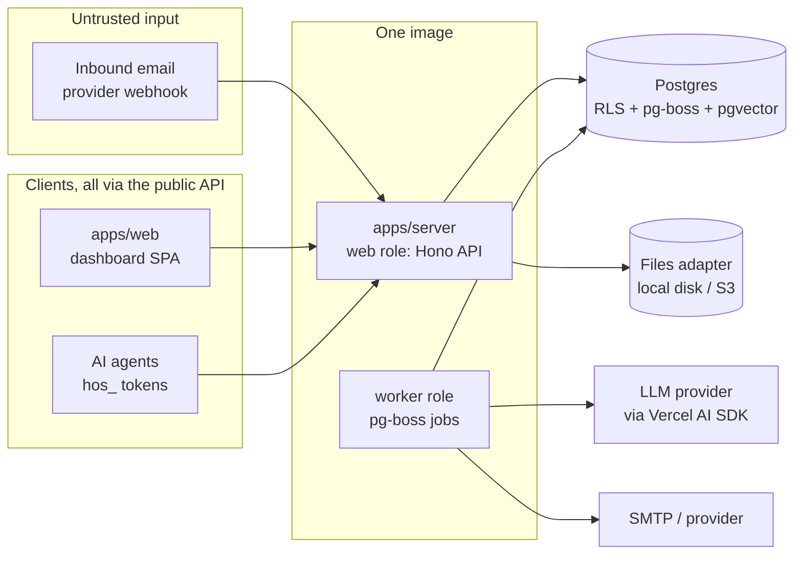
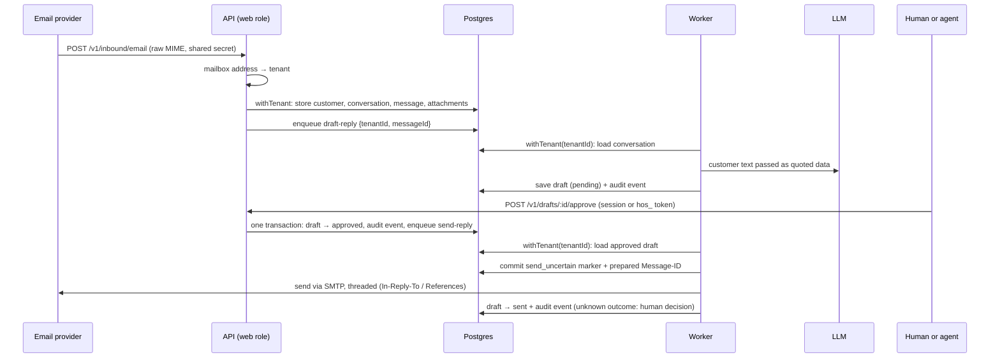

# Architecture overview

How the pieces of HelpOS fit together. This page **summarises** the ADRs in [`docs/adr/`](../adr/) and must never contradict them. If they disagree, the ADR wins and this page gets fixed.

## Components

One Node.js 24 Docker image runs in two roles, plus Postgres (ADR 0002). Postgres must be 15 or later with pgvector: the migrations use `ON DELETE SET NULL (column)`. Development and tests use 17.

| Unit                  | Role                                                                                                                                                                                                                      | May import                         |
| --------------------- | ------------------------------------------------------------------------------------------------------------------------------------------------------------------------------------------------------------------------- | ---------------------------------- |
| `apps/server`         | HTTP API: routes, auth middleware, validation (Zod), OpenAPI spec at `/openapi.json`                                                                                                                                      | any `packages/*`                   |
| worker role           | Background jobs (AI drafts, sending, webhooks). Same code as `apps/server`, started in a different mode. Runs inside the server process for now (#18 splits it out)                                                       | any `packages/*`                   |
| `apps/web`            | Dashboard: React + Vite SPA, TanStack Router/Query, components copied in from beUI's shadcn registry. Uses **only** a client generated from `/openapi.json`. Served by the server from the same origin under a strict CSP | `packages/brand`, generated client |
| `packages/db`         | Drizzle schema, migrations, `withTenant()`. **The only place that touches the raw DB client** (ADR 0003, enforced by Biome)                                                                                               | —                                  |
| `packages/ai`         | Builds the AI model from env, prompt helpers, the mock model for tests                                                                                                                                                    | —                                  |
| `packages/brand`      | Product name and branding. Never hardcode the name                                                                                                                                                                        | —                                  |
| `packages/safe-fetch` | SSRF-safe HTTP GET for imports and webhooks: blocks private, loopback, link-local and metadata addresses after DNS and on every redirect; timeouts and size limits                                                        | —                                  |
| `packages/ai` evals   | AI eval cases, run by `pnpm eval` (ADR 0005)                                                                                                                                                                              | `packages/ai`                      |

Each feature (inbound email, drafts, tokens…) is a folder inside `apps/server` that owns its routes, domain logic and tests (AGENTS.md). Pure domain logic stays separate from I/O. A draft is written only by `apps/server/src/drafts/lifecycle.ts`: one table of allowed status changes, and named operations (create a reply, approve, discard, mark sent or failed, retry) that each make the change, check the status it starts from, and record the audit event, in the caller's transaction. Routes and the workers call those; a lint check fails on a drafts write anywhere else.

Conversation and message writes belong to `apps/server/src/conversations/lifecycle.ts`, including inbound threading, outbound preparation and confirmation, AI-paused markers, closing, and seed snapshots. Callers supply their tenant transaction. Close and pause operations record the existing audit events with an explicit `AuditContext`; draft operations retain their send events. Adding a message or reopening a conversation has no separate audit event in the current vocabulary. The `conversation-writes` Biome plugin rejects writes outside this module, except test fixtures. Seed snapshots preserve their IDs, dates, and audit history without replaying live transitions.

Both roles are built by one function, `composeServer()` (`apps/server/src/server.ts`), from one set of services: the database, files, AI models, mail transport, clock and settings. `main.ts` and the end-to-end test server both use it, so the API and the worker can't end up with different settings or two copies of a store. Every background job is declared once, in `apps/server/src/jobs.ts`: its queue, its retry policy, its handler and its give-up handler. Every queue is created from that list (by the worker, the seed and the tests). The give-up handler is required by its type. It runs once after the last retry fails, and leaves a state people can see plus an audit event: a reply that can't be drafted marks its conversation `draft_failed` (the dashboard offers to ask the AI again or write the reply), a send becomes `send_failed`, a source that can't be ingested becomes `failed`, and a notice that gives up is recorded on its conversation.

Swappable pieces sit behind small interfaces so self-hosters aren't locked in (ADR 0002): files (`local disk` | S3), search, realtime (`Broadcaster`), email transport, AI provider.

## Main flow: email → conversation → draft → approve → send

Only the worker sends email. Approval, its audit event and the pg-boss job commit together. Before calling SMTP, the worker commits the prepared outbound message, its Message-ID and a `send_uncertain` marker. This marker is visible immediately, including if the worker dies on its last attempt and no retry runs. Its outbound message has no `sentAt` until delivery is confirmed. Until then, the conversation history and the AI's view of the conversation (reply and issue drafts) leave it out.

The worker then locks and rechecks that exact attempt, calls SMTP and commits `sent`. A retry that finds the marker sends nothing. SMTP accepting a reply followed by a failed COMMIT, a lost SMTP response or a worker crash therefore cannot cause an automatic resend. Message-ID deduplication by the recipient is not assumed.

A human with `drafts:approve` resolves uncertainty through `POST /v1/drafts/{id}/resolve-send`, bound to the Message-ID they reviewed. **Mark sent** records their confirmation without sending. **Send again** grants one fresh attempt with a new Message-ID, and may deliver a duplicate. The previous uncertainty remains visible if this attempt fails. Agent tokens cannot make either decision. The conversation shows the decision and the inbox flags it for attention.

Only failures before SMTP and explicit SMTP rejection responses can retry automatically. After eight retries, those become `send_failed`, which can be retried or discarded. An unclassified transport error is uncertain, even if it may have happened before delivery. The separate known lost-retry and failed give-up paths can still strand an `approved` draft. The formal verification skill records those limits.

Before drafting, the worker retrieves the best-matching knowledge passages for the email through a `SearchProvider` (pgvector, inside a short `withTenant()` transaction) and quotes them to the model as data, next to the email. The model lists the passages it used on a last line, which is stripped from the reply; the draft records every passage it saw and which ones it cited, so the approver can check the sources. Knowledge sources are added through `POST /v1/knowledge/sources`, edited through `PATCH /v1/knowledge/sources/{id}` (a title or visibility change applies at once; a content change removes the old passages at once and re-ingests that source only), and turned into embedded passages by an `ingest-source` job, which fetches URLs only through `packages/safe-fetch`. The job fetches and embeds with no transaction open (`runner.workInSteps`, each step still in `withTenant()`), so a slow site holds no connection or row lock; it locks the source only to write, and checks that no newer re-ingest request came in meanwhile. If every try of the job fails on a database error, the source is marked `failed`, unless a newer request came in after the job was queued (the job carries the request count it was queued for): that request gets a fresh job instead. A page that fails on a temporary error (a 5xx, a timeout) is tried again a few seconds later. If the site or the embedding provider is still down, the source enters `waiting` with a typed reason and retry time and gets one more try 15 minutes later, then fails. A spent daily budget doesn't fail a source either: it waits, and runs again after midnight UTC. The source stores `pending`, `ready`, `failed` with a typed reason, or `waiting` with a typed reason and retry time in one state object. A separate retry count preserves the retry allowance through budget waits. Each source is `public` (may be shown or cited to customers) or `internal` (the default: the team's own notes). Drafts use both, because a human approves them, but internal passages go to the model marked as private and without their address. Every search requires an audience, `approver` or `customer`. The draft worker uses `approver`. Customer searches filter to `public` inside `packages/db`, before the result limit. The same predicate checks whether any searchable knowledge exists before paying for query embeddings.

Every AI call (a reply draft with its knowledge search, a knowledge source's embeddings) is paid for the same way, through `aiBudget()` in `apps/server/src/ai-budget/budget.ts`, against one hard daily token budget per workspace (UTC days). It first reserves an upper bound of the call's cost (the prompt's UTF-8 bytes, which no byte-level tokenizer exceeds, plus the output cap) in one statement, in a short transaction that commits before the call, so concurrent calls can't all pass the cap: a reservation is refused once spend plus the reservations in flight reach the budget. The call then runs with no transaction or lock held, and the reservation is settled in its own transaction to what the call cost, success or failure (a failed call whose cost can't be told keeps the whole reservation counted). Every call is aborted after 4 minutes, or as soon as the server starts shutting down, and settled before the database closes; the shared reservation window runs out 10 minutes after the newest reservation. On the next budget read or reservation, expired holds become conservative spend because the provider may already have billed them. Late settlements retain that bound. SDK calls make one attempt; job retries reserve again. A refusal is either `over_budget` (spent: the conversation is marked paused and its draft job runs again just after midnight UTC, unless the conversation was closed meanwhile; a knowledge source waits until then) or `busy` (calls in flight hold the rest: the worker returns a 30-second deferral; the runner enqueues its successor with only the remaining failure retries, then completes the old job without consuming another attempt). `GET /v1/ai-usage` shows settled spend and conservative charges for expired holds, not live reservations. A Biome plugin (`biome-plugins/ai-usage.grit`) stops anything else writing `ai_usage`.

Owners also hear when there is something to approve. Every new pending draft queues a `draft-notice` job in the same transaction, delayed by 5 minutes. A draft approved within that time never causes an email. The job emails the workspace owners a short notice that links to the conversation, at most once per conversation every 15 minutes. The subject never contains customer text, and the body quotes one short plain-text line. The notice comes from the workspace mailbox, but its `Reply-To` is a `no-reply@` address that is not a helpdesk mailbox, so an owner who answers it doesn't open a conversation. Owner emails are read through a narrow auth-store function, because the app role can't read `auth.users`.

HTML-only email and imported knowledge pages share the parser in `@helpos/ai/html-text`. It drops hidden subtrees identified by HTML attributes and inline styles, including `display:none`, `visibility:hidden` and `aria-hidden="true"`. Email keeps plain line breaks; knowledge keeps headings, code blocks and article selection. Stylesheets and CSS classes are not evaluated. Plain-text email parts still take precedence. The hidden-HTML eval runs the same email extraction before calling the model.

The conversation shows the API's message text as its primary content, so an approver can read the source text used for AI drafting, retrieval and history. Draft prompts still apply their own input limits and fence removal. Sanitized HTML is available under "Formatted email" as a separate presentation. It can differ from the message text because MIME parts can disagree and display sanitization can remove content the extractor keeps. The formatted view never replaces the message text.

## Core data model

Every tenant table has `tenant_id` with RLS enabled and forced (ADR 0003), except `tenants` itself, and users live in the separate `auth` schema (ADR 0009), linked to workspaces by `memberships`. IDs are UUIDv7. Every table has `created_at`/`updated_at`.

Each table, its owner column, the roles and special grants, and how to add a table are in [data-model.md](data-model.md). A leak test keeps that page complete.

## Trust boundaries

The [threat model](../security/threat-model.md) maps every boundary, the threats that cross it, and the rules the gate must hold. The list below is what holds today.

1. **Everything that comes in is data, never instructions** (ADR 0004): emails, attachments, imported pages. It is quoted to the AI, never merged into its instructions, and AI output can't trigger an action without the policy and approval path.
2. **Every request is authenticated.** Humans use a Better Auth session: an HttpOnly, SameSite=Lax cookie from `POST /v1/auth/sign-in`, resolved to the user's oldest membership. A cookie-authenticated write whose `Origin` isn't the dashboard's is refused (CSRF). There is no sign-up: `pnpm helpos:init` prints a one-time link (token in the URL fragment, stored only hashed) for the owner to set a password. Agents use a scoped `hos_` token. Webhooks use a shared secret or HMAC signature. Each one resolves to _tenant + actor + scopes_ before any data access. A token is stored only as its SHA-256 and looked up by that hash through a read-only policy that shows the one matching row, the same way inbound mail finds its mailbox. Tokens are created by a human with `workspace:admin`, never by another token, can't hold `workspace:admin` themselves, and are revoked rather than deleted, so the audit log can always name the agent. The operator can also create them with `pnpm helpos:token`.
3. **Customer HTML is never trusted.** The API returns it only sanitised (an allow-list of tags and attributes, no scripts, remote images replaced by their alt text), and the dashboard renders it in a sandboxed iframe without `allow-scripts`, under the dashboard's CSP plus its own.
4. **Every data access goes through `withTenant()`**, so the database itself refuses cross-tenant reads (ADR 0003).
5. **Every action is audit-logged** in the same transaction as the action.
6. **Nothing reaches a customer without approval.** There is no auto-send.

## Shortcuts before the first real reply

HelpOS isn't released yet. To stay small, the code takes some shortcuts. ADR 0004 says its controls are required "from the first release", so all of these must land before shadow mode is turned off (set C, first real reply, in the [roadmap](../roadmap.md)) and before any public release or hosted sign-up. Until then, shadow mode (#66) sends every reply to the workspace owner, never to a real customer:

| Shortcut today                             | Required before release                   |
| ------------------------------------------ | ----------------------------------------- |
| Sender identity is just the `From` address | SPF/DKIM/DMARC checks (#31)               |
| Approve endpoint + scopes only             | Policy layer, caps, kill switch (#13)     |
| No rate limits                             | Rate limiting (#29)                       |
| Plain-text AI drafts                       | Output sanitisation and PII masking (#52) |

## Where to read more

- Decisions: [`docs/adr/`](../adr/)
- What is in the database and who may touch it: [`data-model.md`](data-model.md)
- What PR reviews check, as checklists for authors and the AI checks: [`docs/checks/`](../checks/README.md)
- What we build, in which order: [`docs/roadmap.md`](../roadmap.md) (one GitHub milestone per set)

Migration 0020 preserves knowledge source content and passages. Historical waits use migration time for `retryAt` because sources did not record that time. Existing queued jobs keep their schedules. Unknown legacy reasons abort the migration rather than discard data.
