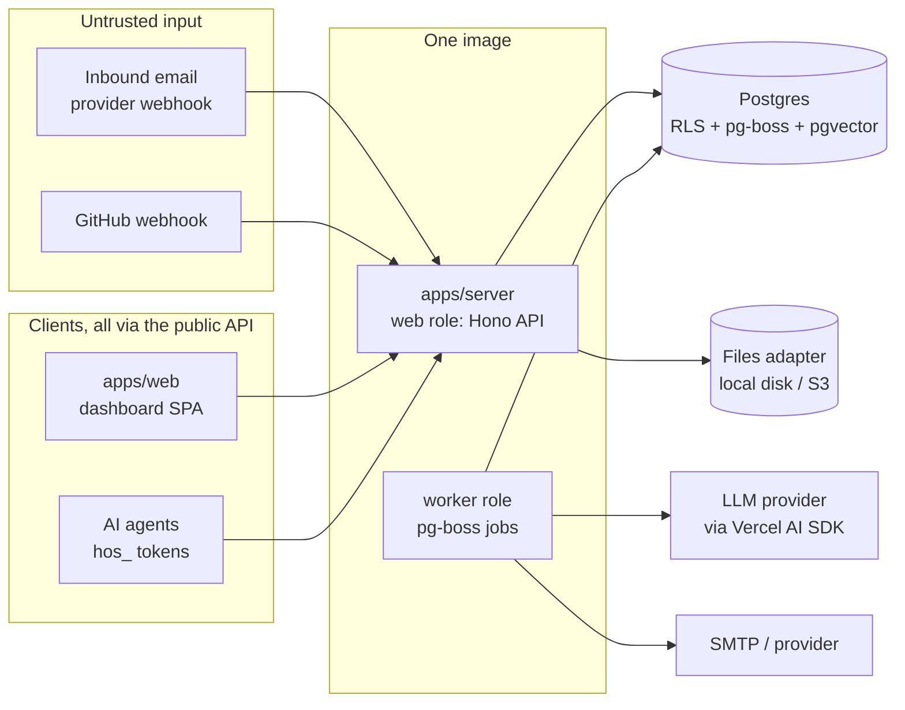
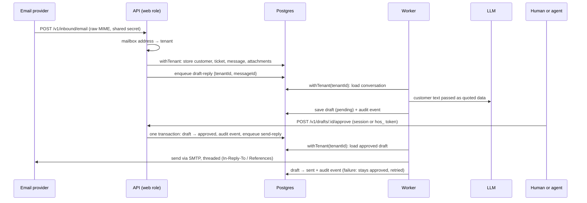

# Architecture overview

How the pieces of HelpOS fit together. This page **summarises** the ADRs in [`docs/adr/`](../adr/) and must never contradict them. If they disagree, the ADR wins and this page gets fixed.

## Components

One Node.js 24 Docker image runs in two roles, plus Postgres (ADR 0002).

| Unit                  | Role                                                                                                                                                                  | May import                         |
| --------------------- | --------------------------------------------------------------------------------------------------------------------------------------------------------------------- | ---------------------------------- |
| `apps/server`         | HTTP API: routes, auth middleware, validation (Zod), OpenAPI spec at `/openapi.json`                                                                                  | any `packages/*`                   |
| worker role           | Background jobs (AI drafts, sending, webhooks). Same code as `apps/server`, started in a different mode. Inside the server process during the MVP (#18 splits it out) | any `packages/*`                   |
| `apps/web`            | Dashboard: React + Vite SPA, TanStack Router/Query, shadcn/ui. Uses **only** a client generated from `/openapi.json`                                                  | `packages/brand`, generated client |
| `packages/db`         | Drizzle schema, migrations, `withTenant()`. **The only place that touches the raw DB client** (ADR 0003, enforced by Biome)                                           | —                                  |
| `packages/ai`         | Builds the AI model from env, prompt helpers, the mock model for tests                                                                                                | —                                  |
| `packages/brand`      | Product name and branding. Never hardcode the name                                                                                                                    | —                                  |
| `packages/safe-fetch` | SSRF-safe HTTP GET for imports and webhooks: blocks private, loopback, link-local and metadata addresses after DNS and on every redirect; timeouts and size limits    | —                                  |
| `evals/`              | AI eval cases, run by `pnpm eval` (ADR 0005)                                                                                                                          | `packages/ai`                      |

Each feature (inbound email, drafts, tokens, GitHub…) is a folder inside `apps/server` that owns its routes, domain logic and tests (AGENTS.md). Pure domain logic stays separate from I/O.

Swappable pieces sit behind small interfaces so self-hosters aren't locked in (ADR 0002): files (`local disk` | S3), search, realtime (`Broadcaster`), email transport, AI provider.

## Main flow: email → ticket → draft → approve → send

Only the worker sends email, so only the worker role needs SMTP settings. An SMTP send can't be part of a database transaction, so approving doesn't send directly. Because pg-boss lives in Postgres, the approval, its audit event and the `send-reply` job commit together: either all three happen or none do. The job retries a failed send, and the draft stays `approved` until the send succeeds.

The full MVP loop adds one more step (#37): a ticket becomes a GitHub issue, and when that issue is closed, a "fixed" draft goes through the same approve-and-send flow.

## Core data model

Every table below has `tenant_id` with RLS enabled and forced (ADR 0003), **except** `tenants` itself and `users`. A user can belong to several workspaces, so `users` has no single tenant. It's protected as decided in [ADR 0009](../adr/0009-tenant-isolation-extended.md), and `memberships` links it to tenants. IDs are UUIDv7. Every table has `created_at`/`updated_at`.

| Table          | What it is                                                       |
| -------------- | ---------------------------------------------------------------- |
| `tenants`      | A workspace (the UI says "workspace")                            |
| `users`        | Humans (Better Auth tables in the `auth` schema, no `tenant_id`) |
| `memberships`  | Which workspaces a user belongs to (tenant table, RLS)           |
| `mailboxes`    | Support addresses. Inbound mail is routed to a tenant by address |
| `customers`    | People who write in                                              |
| `tickets`      | A conversation with a customer                                   |
| `messages`     | Inbound and outbound emails on a ticket                          |
| `attachments`  | Metadata; the bytes live in the files adapter                    |
| `drafts`       | AI-written replies: `pending → approved → sent`, or `discarded`  |
| `api_tokens`   | Agent tokens: hashed, scoped, revocable (`hos_…`)                |
| `audit_events` | Append-only log of every human and agent action                  |
| `integrations` | e.g. the linked GitHub repo and its encrypted token              |

## Trust boundaries

1. **Everything that comes in is data, never instructions** (ADR 0004): emails, attachments, GitHub text, imported pages. It is quoted to the AI, never merged into its instructions, and AI output can't trigger an action without the policy and approval path.
2. **Every request is authenticated.** Humans use a Better Auth session. Agents use a scoped `hos_` token. Webhooks use a shared secret or HMAC signature. Each one resolves to _tenant + actor + scopes_ before any data access.
3. **Every data access goes through `withTenant()`**, so the database itself refuses cross-tenant reads (ADR 0003).
4. **Every action is audit-logged** in the same transaction as the action.
5. **Nothing reaches a customer without approval.** There is no auto-send in the MVP.

## MVP vs first release

The MVP (milestone **MVP**) is a demo to learn from, **not a release**. To stay small, it takes some shortcuts. ADR 0004 says its controls are required "from the first release", so all of these must land before shadow mode is turned off (Set 2a in the [roadmap](../roadmap.md)) and before any public release or hosted sign-up. Until then, shadow mode (#66) sends every reply to the design partner, never to a real customer:

| MVP shortcut                               | Required before release                   |
| ------------------------------------------ | ----------------------------------------- |
| Sender identity is just the `From` address | SPF/DKIM/DMARC checks (#31)               |
| Approve endpoint + scopes only             | Policy layer, caps, kill switch (#13)     |
| One env key encrypts the GitHub token      | Envelope encryption (#15)                 |
| No rate limits                             | Rate limiting (#29)                       |
| Basic per-table leak tests                 | Full leak harness (#8)                    |
| Plain-text AI drafts                       | Output sanitisation and PII masking (#52) |

## Where to read more

- Decisions: [`docs/adr/`](../adr/)
- What we build, in which order: [`docs/roadmap.md`](../roadmap.md) (one GitHub milestone per set)
