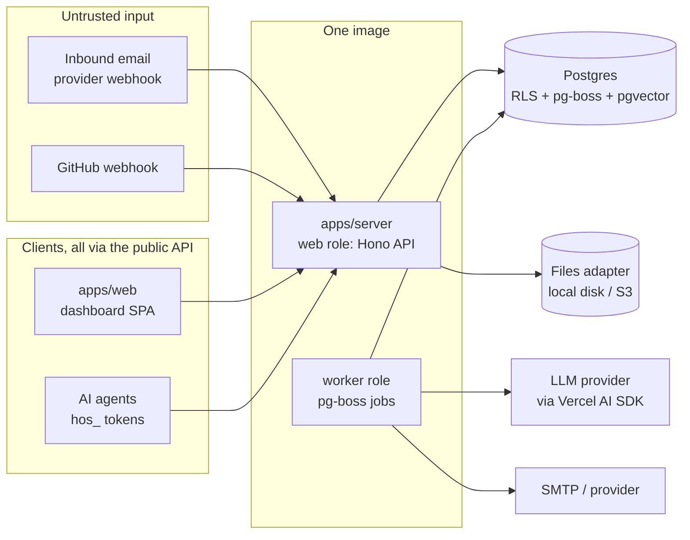
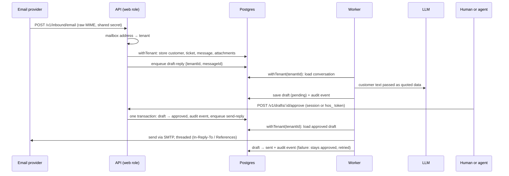
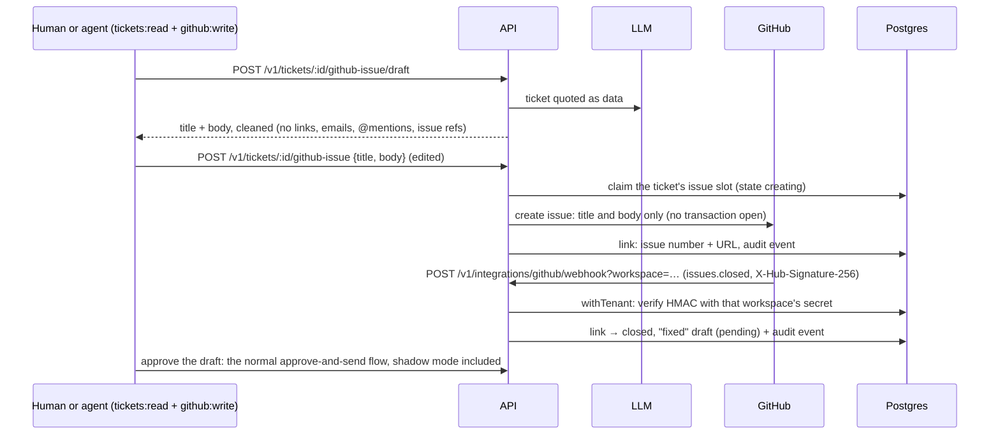

# Architecture overview

How the pieces of HelpOS fit together. This page **summarises** the ADRs in [`docs/adr/`](../adr/) and must never contradict them. If they disagree, the ADR wins and this page gets fixed.

## Components

One Node.js 24 Docker image runs in two roles, plus Postgres (ADR 0002). Postgres must be 15 or later with pgvector: the migrations use `ON DELETE SET NULL (column)`. Development and tests use 17.

| Unit                  | Role                                                                                                                                                                                                                      | May import                         |
| --------------------- | ------------------------------------------------------------------------------------------------------------------------------------------------------------------------------------------------------------------------- | ---------------------------------- |
| `apps/server`         | HTTP API: routes, auth middleware, validation (Zod), OpenAPI spec at `/openapi.json`                                                                                                                                      | any `packages/*`                   |
| worker role           | Background jobs (AI drafts, sending, webhooks). Same code as `apps/server`, started in a different mode. Inside the server process during the MVP (#18 splits it out)                                                     | any `packages/*`                   |
| `apps/web`            | Dashboard: React + Vite SPA, TanStack Router/Query, components copied in from beUI's shadcn registry. Uses **only** a client generated from `/openapi.json`. Served by the server from the same origin under a strict CSP | `packages/brand`, generated client |
| `packages/db`         | Drizzle schema, migrations, `withTenant()`. **The only place that touches the raw DB client** (ADR 0003, enforced by Biome)                                                                                               | —                                  |
| `packages/ai`         | Builds the AI model from env, prompt helpers, the mock model for tests                                                                                                                                                    | —                                  |
| `packages/brand`      | Product name and branding. Never hardcode the name                                                                                                                                                                        | —                                  |
| `packages/safe-fetch` | SSRF-safe HTTP GET for imports and webhooks: blocks private, loopback, link-local and metadata addresses after DNS and on every redirect; timeouts and size limits                                                        | —                                  |
| `evals/`              | AI eval cases, run by `pnpm eval` (ADR 0005)                                                                                                                                                                              | `packages/ai`                      |

Each feature (inbound email, drafts, tokens, GitHub…) is a folder inside `apps/server` that owns its routes, domain logic and tests (AGENTS.md). Pure domain logic stays separate from I/O.

Swappable pieces sit behind small interfaces so self-hosters aren't locked in (ADR 0002): files (`local disk` | S3), search, realtime (`Broadcaster`), email transport, AI provider.

## Main flow: email → ticket → draft → approve → send

Only the worker sends email, so only the worker role needs SMTP settings. An SMTP send can't be part of a database transaction, so approving doesn't send directly. Because pg-boss lives in Postgres, the approval, its audit event and the `send-reply` job commit together: either all three happen or none do. The job retries a failed send, and the draft stays `approved` until the send succeeds.

Before drafting, the worker retrieves the best-matching knowledge passages for the email through a `SearchProvider` (pgvector, inside the same `withTenant()` transaction) and quotes them to the model as data, next to the email. The model lists the passages it used on a last line, which is stripped from the reply; the draft records every passage it saw and which ones it cited, so the approver can check the sources. Knowledge sources are added through `POST /v1/knowledge/sources`, edited through `PATCH /v1/knowledge/sources/{id}` (a title or visibility change applies at once; a content change removes the old passages at once and re-ingests that source only), and turned into embedded passages by an `ingest-source` job, which fetches URLs only through `packages/safe-fetch`. The job fetches and embeds with no transaction open (`runner.workInSteps`, each step still in `withTenant()`), so a slow site holds no connection or row lock; it locks the source only to write, and checks that no newer re-ingest request came in meanwhile. A page that fails on a temporary error (a 5xx, a timeout) is tried again a few seconds later. If the site or the embedding provider is still down, the source stays `pending` with the reason and gets one more try 15 minutes later, then fails. A spent daily budget doesn't fail a source either: it waits, and runs again after midnight UTC. Each source is `public` (may be shown or cited to customers) or `internal` (the default: the team's own notes). Drafts use both, because a human approves them, but internal passages go to the model marked as private and without their address; anything a customer sees unreviewed must search `public` only.

Owners also hear when there is something to approve. Every new pending draft queues a `draft-notice` job in the same transaction, delayed by 5 minutes (`HELPOS_NOTICE_DELAY_SECONDS`). A draft approved within that time never causes an email. The job emails the workspace owners a short notice that links to the ticket, at most once per ticket every 15 minutes. The subject never contains customer text, and the body quotes one short plain-text line. The notice comes from the workspace mailbox, but its `Reply-To` is a `no-reply@` address that is not a helpdesk mailbox, so an owner who answers it doesn't open a ticket. Owner emails are read through a narrow auth-store function, because the app role can't read `auth.users`.

## The GitHub loop: ticket → issue → "it's fixed"

A workspace connects one repo with a fine-grained personal access token (Issues read and write); classic tokens, which reach every repo their owner can, are refused. Only a human with `workspace:admin` can connect it. The token is checked with GitHub (the repo, and the token's own account, which finding a lost issue needs), then stored encrypted with AES-256-GCM under `HELPOS_ENCRYPTION_KEY`, bound to the workspace, together with a webhook secret we generate. Neither is ever logged or returned again; the secret is shown once, for the admin to paste into GitHub. An admin can replace it at any time without the token (`POST /v1/integrations/github/webhook-secret`), e.g. after a leak. One server key is an MVP shortcut: envelope encryption (#15) replaces it.

GitHub can't make opening an issue idempotent, so every issue's body ends with a hidden `<!-- helpdesk-claim:<id> -->` line naming the claim that opened it. When GitHub's answer is lost (a timeout, a 5xx), the server looks for that exact marker, on an issue opened by the token's own account (anyone who can read the repo could copy a marker into an issue of theirs), before giving up. If it isn't found yet, the claim stays, so a retry is refused (`creation_pending`) rather than opening a second issue, and once the claim is stale the next try looks for the marker again first. An issue opened but not linkable is reported with its address. The AI draft reserves an upper bound of its cost (the prompt's UTF-8 bytes, which no byte-level tokenizer exceeds, plus the output cap) from the daily budget in one statement, so concurrent drafts can't all pass the cap, then swaps it for the real figure (a failed call keeps it counted unless its cost is known); no lock or transaction is held while the model writes, so it never holds up reply drafting.

The AI only fills text fields, and the API sends GitHub only a title and a body, so neither the AI nor a caller can add labels, assignees or milestones. The AI's text is cleaned in code afterwards, so a prompt injection that fools the model still can't make the issue ping people, link other issues or carry a link (even the customer's own: they wrote it). Issue text an agent posts is cleaned the same way, since an agent reads customer text too; a person's own text is sent as written. Mentions, issue references, character references and HTML go into code spans, where GitHub shows them as typed and acts on none of them. The webhook names its workspace in the URL. The handler opens `withTenant()` for it and checks the signature with that workspace's secret: an unknown workspace and a bad signature get the same 401, and no global "repo → workspace" lookup exists to probe. GitHub signs no timestamp, so replays are made harmless by state: a link that's already `closed` ignores another `closed`. Each link also keeps GitHub's own time (`updated_at`) of the last close or reopen applied, so a close delivered late, after a reopen, changes nothing; an event in the very second of the last change can't be ordered, so the worker reads the issue's state from GitHub instead. Tickets are matched by the event's own repo and issue number, so a ticket linked while another repo was connected still hears when its issue closes. A request without a well-formed signature header is refused before any database work. A workspace's secret, once read, is kept in memory for a minute (forgotten at once when it is connected, rotated or disconnected), so a forged request naming a workspace looked up moments ago is refused with no database work at all; lookups that do reach the database run one per workspace at a time, a few at a time overall, the rest waiting their turn (each workspace's URL holding only a share of the line, and workspaces that have had a delivery verified waiting in a line of their own that goes first, which a forged request can never join), so a flood of forged ones can't take the database pool and only slows real ones down. Reopening an issue withdraws a "fixed" draft still waiting for approval, and if the issue closes again a fresh one is drafted. An issue already closed when its link is written (a fast maintainer, or one found again later) is caught by a state check right after linking; if GitHub can't be reached for it, a background job (`github.recheck-issue`) checks again later, for up to a day. Only an issue closed as `completed` makes a "fixed" draft; `not_planned` and `duplicate` don't. The draft is a fixed text with nothing from the issue in it, and a human approves it like any reply.

## Core data model

Every table below has `tenant_id` with RLS enabled and forced (ADR 0003), **except** `tenants` itself and `users`. A user can belong to several workspaces, so `users` has no single tenant. It's protected as decided in [ADR 0009](../adr/0009-tenant-isolation-extended.md), and `memberships` links it to tenants. IDs are UUIDv7. Every table has `created_at`/`updated_at`.

| Table                  | What it is                                                               |
| ---------------------- | ------------------------------------------------------------------------ |
| `tenants`              | A workspace (the UI says "workspace")                                    |
| `users`                | Humans (Better Auth tables in the `auth` schema, no `tenant_id`)         |
| `memberships`          | Which workspaces a user belongs to (tenant table, RLS)                   |
| `mailboxes`            | Support addresses. Inbound mail is routed to a tenant by address         |
| `customers`            | People who write in                                                      |
| `tickets`              | A conversation with a customer                                           |
| `messages`             | Inbound and outbound emails on a ticket                                  |
| `attachments`          | Metadata; the bytes live in the files adapter                            |
| `drafts`               | Replies and "fixed" notices: `pending → approved → sent`, or `discarded` |
| `draft_citations`      | Knowledge passages a draft was written with, and which it cited          |
| `knowledge_sources`    | Pages and docs for the AI, `public` or `internal`; app or git (ADR 0010) |
| `knowledge_chunks`     | Embedded passages of a source (pgvector, searched per ADR 0009 §4)       |
| `api_tokens`           | Agent tokens: hashed, scoped, revocable (`hos_…`)                        |
| `audit_events`         | Append-only log of every human and agent action                          |
| `integrations`         | The linked GitHub repo, its token and webhook secret (both encrypted)    |
| `ticket_github_issues` | The GitHub issue made from a ticket, and whether it's open or closed     |

## Trust boundaries

1. **Everything that comes in is data, never instructions** (ADR 0004): emails, attachments, GitHub text, imported pages. It is quoted to the AI, never merged into its instructions, and AI output can't trigger an action without the policy and approval path.
2. **Every request is authenticated.** Humans use a Better Auth session: an HttpOnly, SameSite=Lax cookie from `POST /v1/auth/sign-in`, resolved to the user's oldest membership. A cookie-authenticated write whose `Origin` isn't the dashboard's is refused (CSRF). There is no sign-up: `pnpm helpos:init` prints a one-time link (token in the URL fragment, stored only hashed) for the owner to set a password. Agents use a scoped `hos_` token. Webhooks use a shared secret or HMAC signature. Each one resolves to _tenant + actor + scopes_ before any data access. A token is stored only as its SHA-256 and looked up by that hash through a read-only policy that shows the one matching row, the same way inbound mail finds its mailbox. Tokens are created by a human with `workspace:admin`, never by another token, can't hold `workspace:admin` themselves, and are revoked rather than deleted, so the audit log can always name the agent. The operator can also create them with `pnpm helpos:token`.
3. **Customer HTML is never trusted.** The API returns it only sanitised (an allow-list of tags and attributes, no scripts, remote images replaced by their alt text), and the dashboard renders it in a sandboxed iframe without `allow-scripts`, under the dashboard's CSP plus its own.
4. **Every data access goes through `withTenant()`**, so the database itself refuses cross-tenant reads (ADR 0003).
5. **Every action is audit-logged** in the same transaction as the action.
6. **Nothing reaches a customer without approval.** There is no auto-send in the MVP.

## MVP vs first release

The MVP (milestone **MVP**) is a demo to learn from, **not a release**. To stay small, it takes some shortcuts. ADR 0004 says its controls are required "from the first release", so all of these must land before shadow mode is turned off (Set 2a in the [roadmap](../roadmap.md)) and before any public release or hosted sign-up. Until then, shadow mode (#66) sends every reply to the design partner, never to a real customer:

| MVP shortcut                               | Required before release                   |
| ------------------------------------------ | ----------------------------------------- |
| Sender identity is just the `From` address | SPF/DKIM/DMARC checks (#31)               |
| Approve endpoint + scopes only             | Policy layer, caps, kill switch (#13)     |
| One env key encrypts the GitHub token      | Envelope encryption (#15)                 |
| No rate limits                             | Rate limiting (#29)                       |
| Basic per-table leak tests                 | Full leak harness (#8)                    |
| Plain-text AI drafts                       | Output sanitisation and PII masking (#52) |

## Where to read more

- Decisions: [`docs/adr/`](../adr/)
- What we build, in which order: [`docs/roadmap.md`](../roadmap.md) (one GitHub milestone per set)
