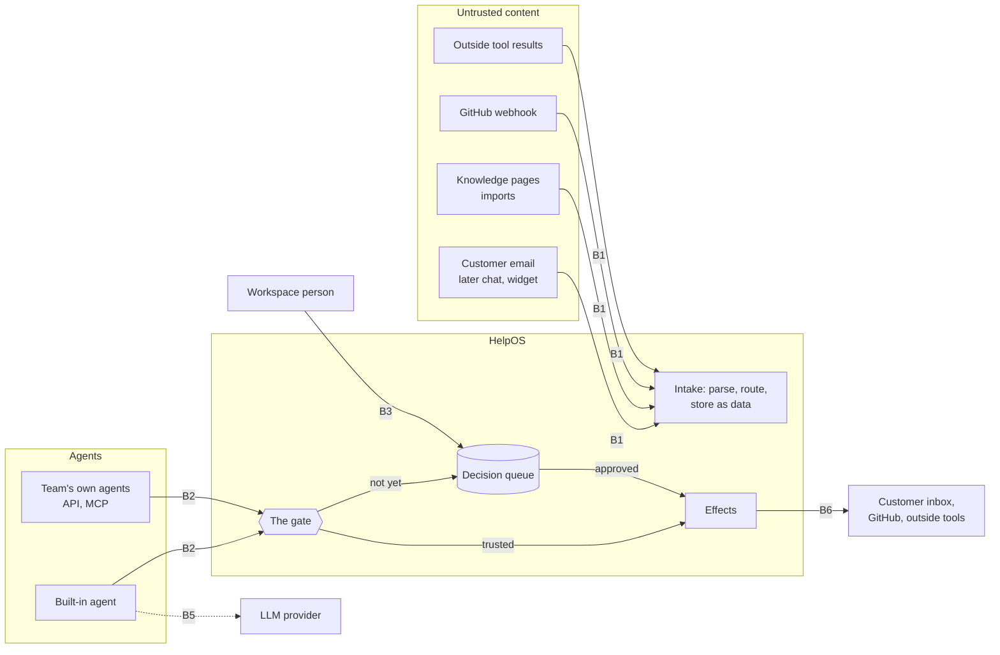

# Threat model

What can go wrong in an agent-first helpdesk, where trust changes hands, and which control holds at each place. Issues that build a control cite the IDs on this page: boundaries `B1`–`B8`, gate rules `G1`–`G12` and threats `T1`–`T19`.

**Status.** First pass, written before the gate (#13) is designed. It says what the gate must guarantee, not how. [ADR 0004](../adr/0004-security-baseline.md) is the list of controls, and this page maps threats to them. If the two disagree, the ADR wins until a new ADR changes it.

## When to update this page

Update this page in the same PR when a change does any of these:

- adds a channel or a new way for outside content to come in (chat, a widget, Slack, an import, a connector)
- gives agents a new capability: an action type, a scope, a tool (#174), or a new way in (MCP #19, webhooks #17)
- adds an outside connection that holds a secret
- builds, weakens or removes a control named here, so its "Today" entry changes

The [security-baseline check](../checks/security-baseline.md) flags a PR that does one of these and leaves this page alone.

## What we protect

1. **Each workspace's data.** Conversations, customers, knowledge (internal notes most of all), saved API write results and the audit log.
2. **What goes out in the workspace's name.** A wrong email to a customer can't be unsent.
3. **Authority.** Who may approve, accept a promotion, change limits, turn a kill switch off, and manage tokens.
4. **Secrets.** Agent tokens, session cookies, integration tokens, the server's encryption key and a workspace's own AI key.
5. **Money and capacity.** AI spend, the sending reputation of a domain, and server capacity.

## Actors

| Actor                                                          | Proves who it is with                                                                               | Trusted for                                                 | Never trusted for                                |
| -------------------------------------------------------------- | --------------------------------------------------------------------------------------------------- | ----------------------------------------------------------- | ------------------------------------------------ |
| Customer (the person writing in)                               | Nothing yet. The `From` address is a claim until #31                                                | Its own words, as data                                      | Instructions. Its identity, until verified       |
| A customer's own AI agent, writing or acting for them          | The same as the customer                                                                            | Its words, as data                                          | It is a customer, never one of the desk's agents |
| Workspace person (owner, admin, member)                        | Better Auth session cookie                                                                          | Decisions and human-only actions (admin for tokens, GitHub) | Another workspace's data (`B4`)                  |
| Built-in agent                                                 | Nothing today: it writes as a `system` actor (`draft-worker.ts`). After #13, its own agent identity | Proposals                                                   | Approving, deciding its own trust or limits      |
| The team's own agents (Claude Code, Codex, custom)             | A scoped `hos_` token today. MCP OAuth with audience-bound tokens later (#19)                       | Proposals within its permissions                            | Approving, deciding its own trust or limits      |
| Outside services (email provider, GitHub, LLM provider, tools) | A shared secret, an HMAC signature, TLS                                                             | Delivering bytes                                            | What the bytes say                               |
| Operator (a self-hoster, or the hosted service)                | Access to the server and its settings                                                               | Everything on the box                                       | Out of scope here                                |

An attacker shows up as one of these:

- **An outside sender.** Anyone can email a support address. This is the most common attacker and needs no account.
- **The author of a page or file the desk reads.** A knowledge URL, an imported export, a GitHub issue, a tool's result.
- **A member of another workspace**, trying to reach this one.
- **The holder of a stolen credential.** A `hos_` token, a session cookie, an integration token.
- **A fooled or faulty agent.** Ours or the team's own, doing what injected text told it.
- **Someone with push access to a config repo** but no admin rights in the workspace (ADR 0010).

## Trust boundaries

`B4` (workspace to workspace) runs through every box above. `B7` and `B8` sit around it.

| ID   | Boundary                      | What crosses it                                                                 | The rule                                                                                                           |
| ---- | ----------------------------- | ------------------------------------------------------------------------------- | ------------------------------------------------------------------------------------------------------------------ |
| `B1` | Outside content → the desk    | Email, attachments, knowledge pages, imports, GitHub text, outside tool results | Data, never instructions. It is stored and quoted, never obeyed. A tool's result is outside content too            |
| `B2` | An agent → the gate           | Every action an agent wants                                                     | The only way an agent's wish becomes an effect. Every agent crosses it the same way, the built-in agent included   |
| `B3` | A person → a decision         | Approvals, promotions, turning a kill switch off, token and credential changes  | Only a person. An agent may turn a kill switch on and revoke its own token, nothing more                           |
| `B4` | Workspace ↔ workspace         | Everything                                                                      | The database refuses cross-workspace reads and writes (ADR 0003, ADR 0009): tables, jobs, vectors, realtime        |
| `B5` | The desk → the AI provider    | Customer text and knowledge passages, in prompts                                | Quoted as data, internal passages marked private. Paid for through one budget. Personal data masked (#52)          |
| `B6` | The desk → the outside world  | Customer email, GitHub issues, outside tool calls, outbound webhooks            | Only through the gate. Effects that can't be undone start at "a person approves"                                   |
| `B7` | The operator → the box        | Settings, the encryption key, the database                                      | Trusted. Secrets are encrypted at rest, never logged and never returned by the API                                 |
| `B8` | A git repo → workspace config | Rules, knowledge and settings from git (ADR 0010, later)                        | Push access is not admin. A change that loosens anything waits until an admin approves it in the app (ADR 0010 §5) |

## The gate: what every action must cross

These rules are what the gate issues must prove with tests. They say what must hold, not how. Each one comes from the [vision](../vision.md) rules 1, 3, 5, 6 and 10.

| ID    | Rule                                                                                                                                                                                                                                                                                                                                                                                                                                       | Built by              |
| ----- | ------------------------------------------------------------------------------------------------------------------------------------------------------------------------------------------------------------------------------------------------------------------------------------------------------------------------------------------------------------------------------------------------------------------------------------------ | --------------------- |
| `G1`  | **One gate.** Every action taken through HelpOS, by any agent, passes the same check before it runs. No worker, job or built-in path acts for an agent around it.                                                                                                                                                                                                                                                                          | #13                   |
| `G2`  | **One identity per agent.** The built-in agent has its own identity, permissions, trust and kill switch, like any other agent. No agent action is recorded as `system`. Credit and blame go to the agent that ran. Jobs that carry out what was already decided (sending an approved reply, owner notices, the GitHub webhook, ingesting a source, the operator CLI) stay `system`. The draft worker is the built-in agent, so it doesn't. | #13                   |
| `G3`  | **Off by default, per agent.** Each agent may take only the action types, and touch only the queues, that a person granted it. A new agent, action type or permission can do nothing until then.                                                                                                                                                                                                                                           | #13                   |
| `G4`  | **Agents propose, people decide.** No agent can approve a decision, accept a promotion, turn a kill switch off, change any agent's limits or permissions, manage tokens or credentials beyond revoking its own, or cancel a request for a human. What a token can hold enforces this, not a prompt.                                                                                                                                        | #13, #166, #168, #188 |
| `G5`  | **Approved means exactly that action.** The person sees the action itself, as the desk shows it, not the agent's summary of it. The action that runs is the one approved, checked again when it runs. Anything changed in between doesn't run.                                                                                                                                                                                             | #189                  |
| `G6`  | **Based on the latest version.** A proposal names the conversation version it read. If the conversation has moved on, the proposal is out of date and doesn't run. One owner holds a conversation at a time, and a person can always take over.                                                                                                                                                                                            | #187, #165            |
| `G7`  | **Nothing is resent on its own.** When it's unclear whether an effect happened, such as an email that may have gone out, a person decides.                                                                                                                                                                                                                                                                                                 | #130                  |
| `G8`  | **Caps and the kill switch win at every trust level.** A kill switch stops new and pending actions. Anyone may turn it on. Only a person turns it off. Effects that can't be undone (money, deletions, outbound email) keep hard caps when trusted.                                                                                                                                                                                        | #188                  |
| `G9`  | **Trust is held per agent and per action type, and rises only from real outcomes and a person's yes.** It falls on its own after an edit, a rejection or an unhappy return. Unknown outcomes earn nothing.                                                                                                                                                                                                                                 | #166, #185, #186      |
| `G10` | **Rules never widen authority on their own.** A playbook rule that raises a cap, widens a permission or removes an approval step needs a person's approval, at any trust level and from any source: a person's answer, an agent, or git. For rules from git, that person is an admin (ADR 0010 §5). Tightening applies at once.                                                                                                            | #167, ADR 0010 §5     |
| `G11` | **Every gate decision is audited** with its reason and inputs: ran, held as a decision, or refused.                                                                                                                                                                                                                                                                                                                                        | #13, #85              |
| `G12` | **The desk keeps the customer promises, not the prompt.** Customers know a reply is AI, and "talk to a human" always creates a decision. Injected text can suppress neither.                                                                                                                                                                                                                                                               | #168                  |

## Threats

"Today" says what holds in the code now. "Open" names the issue that closes the rest.

| ID    | Threat                                                                                                                                                                              | Crosses    | Control (ADR 0004 unless named)                                                                                                   | Today                                                                                                                                                                                                                                                                                                                                               | Open                                                                               |
| ----- | ----------------------------------------------------------------------------------------------------------------------------------------------------------------------------------- | ---------- | --------------------------------------------------------------------------------------------------------------------------------- | --------------------------------------------------------------------------------------------------------------------------------------------------------------------------------------------------------------------------------------------------------------------------------------------------------------------------------------------------- | ---------------------------------------------------------------------------------- |
| `T1`  | **Cross-workspace access.** A member, an agent or a bug reads or changes another workspace's data, through a query, a job, a search, a vector, realtime, or a guessable ID.         | `B4`       | Tenant isolation as in ADR 0003 and ADR 0009                                                                                      | RLS enabled and forced on every tenant table, `withTenant()` only, no `BYPASSRLS`, job payloads carry IDs only. `schema.int.test.ts` and `leak.int.test.ts` prove it table by table                                                                                                                                                                 | #8, before the new tables of sets A and B                                          |
| `T2`  | **Prompt injection leads to an action.** Text in an email, a page or a tool result tells the AI to approve, refund, change a rule, or quote internal notes.                         | `B1`, `B2` | Inbound content is data, never instructions. Tools are restricted by context. Write actions are off by default                    | Customer text goes to the model quoted (`<untrusted_email>`), never in its instructions. Real drafting offers the model no tools. Every reply waits for approval, by a person or by a token holding `drafts:approve` (`T3`). Injection cases in `packages/ai/evals/` run on every `pnpm verify`                                                     | #13, #188, #174. Once agents act, the gate is the control, never the prompt        |
| `T3`  | **An agent raises its own authority.** A fooled or faulty agent approves its own proposal, accepts its own promotion, raises a cap, rewrites a rule, or turns the kill switch off.  | `B3`       | Signed approvals, caps, kill switch. Human-only is in the vision, not yet in ADR 0004 (see [gaps](#what-adr-0004-doesnt-say-yet)) | A token can't hold `workspace:admin` or create tokens. Agent tokens can still hold `drafts:approve`                                                                                                                                                                                                                                                 | #13 (`G4`), #166, #167, #188                                                       |
| `T4`  | **The built-in agent skips the gate.** It writes as `system`, outside scopes, so nobody can cap, stop or demote it on its own.                                                      | `B2`       | One identity per agent                                                                                                            | Open: the draft worker records `{ type: "system", id: "draft-reply" }`                                                                                                                                                                                                                                                                              | #13 (`G1`, `G2`)                                                                   |
| `T5`  | **Data leaks through AI output.** The AI is made to put internal notes, another customer's details or a secret into a reply, a link, or an image address that leaks when rendered.  | `B5`, `B6` | AI output is sanitised: no remote images, links through an allowlist or proxy. Personal data is masked before the LLM             | Every reply waits for approval (`T3`), and a draft that quotes an internal note is flagged to the approver (`quotesInternalNote`). Internal passages reach the model marked private and without their address. GitHub issue text is cleaned in code (no links, mentions or issue references). Eval cases prove a draft won't paste an internal note | #52, #178. Anything a customer sees unreviewed must search only `public` knowledge |
| `T6`  | **A sender pretends to be a known customer** to get their data or act on their account.                                                                                             | `B1`       | SPF, DKIM and DMARC before trusting the sender. End users verified before the AI uses their account data                          | MVP shortcut: the `From` address is taken as given. Harmless while the AI reads no account data and shadow mode sends every reply to the owner                                                                                                                                                                                                      | #31, before the first real reply (set C)                                           |
| `T7`  | **Server-side request forgery.** A knowledge URL, an import, a webhook address or an MCP server makes the server fetch an internal address, such as cloud metadata or the database. | `B1`, `B6` | SSRF-safe fetch, checked after DNS and on every redirect                                                                          | `packages/safe-fetch` for knowledge ingestion                                                                                                                                                                                                                                                                                                       | Every new outbound fetch uses it: #17, #174, git sync (ADR 0010)                   |
| `T8`  | **A stolen credential is used.** A `hos_` token, a session cookie or an integration token leaks through a log, a laptop or a CI run.                                                | `B2`, `B7` | Tokens prefixed, hashed, scoped, revocable, one per agent. Envelope encryption for secrets. MCP OAuth with audience-bound tokens  | Tokens stored as SHA-256 and revoked rather than deleted. Errors logged without their message. HttpOnly, SameSite cookie with an `Origin` check on writes. GitHub token sealed with AES-256-GCM under one server key. `G3`, `G4` and `G8` keep a stolen agent token to proposals                                                                    | #12, #15, #19, #29                                                                 |
| `T9`  | **Two writers or a double effect.** Two agents act on one conversation, an agent acts on an old version, or a retry sends a reply twice.                                            | `B2`, `B6` | Write endpoints take idempotency keys                                                                                             | Approval, audit event and send job commit together. One table lists every allowed draft status change. Known bug: a reply can be sent twice if the commit fails after SMTP accepted it (#130)                                                                                                                                                       | #130, #165, #187, #10                                                              |
| `T10` | **Capacity and cost abuse.** An email flood, a reply loop with an auto-responder, or a spammer using the desk to relay mail.                                                        | `B1`, `B6` | Rate limits and bot protection. Outbound send quotas. Auto-reply loop and bounce handling. Hard AI cost caps per workspace        | Auto-replies, bounces and list mail get no AI draft. A daily AI budget per workspace is reserved before every call                                                                                                                                                                                                                                  | #29, #75, #183, #188 (send caps)                                                   |
| `T11` | **Script runs in a person's session.** Customer HTML or AI output runs script in the dashboard, where a person can approve.                                                         | `B1`       | Email HTML in a sandboxed iframe. Strict CSP                                                                                      | Customer HTML is sanitised by the API, shown in an iframe without `allow-scripts`, under a strict CSP                                                                                                                                                                                                                                               | #131 (attachments), the chat widget later                                          |
| `T12` | **A forged or replayed webhook.** A fake "issue closed" from GitHub, or a fake inbound email.                                                                                       | `B1`       | Webhooks signed with HMAC, with a timestamp and a replay window                                                                   | Inbound email needs a shared bearer secret, compared in constant time, with no signature or replay window. A replayed email with a known Message-ID is dropped as a duplicate. GitHub deliveries need the workspace's HMAC. GitHub signs no timestamp, so a replay changes nothing by state                                                         | #190 signs inbound email. #17 signs our outbound webhooks                          |
| `T13` | **Trust is gamed.** An agent, alone or with a customer, makes outcomes look good to earn a promotion. Closing conversations early, for example, means no one comes back unhappy.    | `B3`       | Not in ADR 0004 (see [gaps](#what-adr-0004-doesnt-say-yet))                                                                       | Open: no trust ladder yet. Nothing is sent without approval                                                                                                                                                                                                                                                                                         | #166, #185, #186 (`G9`)                                                            |
| `T14` | **A rule widens authority.** An agent proposes, or a repo push carries, a rule such as "refunds under $5,000 need no person". Or a rule's text carries injected instructions.       | `B3`, `B8` | ADR 0010 §5 and §6                                                                                                                | Open: no playbook yet                                                                                                                                                                                                                                                                                                                               | #167 (`G10`)                                                                       |
| `T15` | **Customer data reaches the AI provider.** Conversation text and knowledge leave the box in prompts.                                                                                | `B5`       | Personal data masked before the LLM. A workspace's own AI key is envelope-encrypted                                               | Only the text a draft needs goes out. One provider and key serve the whole server, set by the operator                                                                                                                                                                                                                                              | #52, #15, #181 (a workspace's own key)                                             |
| `T16` | **Supply chain and CI.** A dependency or a workflow change runs attacker code with repo secrets, or PR text steers the AI review.                                                   | Repo       | Dependabot, dependency review, secret scanning, CodeQL, actions pinned by SHA                                                     | Actions pinned by SHA with `persist-credentials: false`, proven by `workflows.test.mjs`. The AI review reads its rules from the base branch                                                                                                                                                                                                         | #30                                                                                |
| `T17` | **An action leaves no trace.** A change with no audit event can't be found, explained or undone.                                                                                    | All        | Audit log of every human and agent action: who, what, when, why and the inputs                                                    | Every write route declares what it audits, and a success that records nothing fails. Audit events commit in the action's transaction. A job that gives up leaves a visible state                                                                                                                                                                    | #85, #14, `G11`                                                                    |
| `T18` | **Decision flooding.** Many proposals, from a faulty agent or from an attacker's emails, push a person into approving without reading.                                              | `B3`       | Not in ADR 0004 (see [gaps](#what-adr-0004-doesnt-say-yet))                                                                       | Owner notices go out at most once per conversation every 15 minutes. Nothing counts decisions yet                                                                                                                                                                                                                                                   | #77 (decision demand), #166, #188 (action caps)                                    |
| `T19` | **Knowledge poisoning that lasts.** An agent with `knowledge:write`, or a source page that changes after it was added, steers every later draft.                                    | `B1`, `B2` | Inbound content is data, including help articles. ADR 0010 §6 for knowledge from git                                              | Passages are quoted as data. Each draft records the passages it saw and cited, so the approver can check them. Eval cases cover tampered pages                                                                                                                                                                                                      | #13 (knowledge writes go through the gate), #176 (revisions and staleness)         |

## What ADR 0004 doesn't say yet

The vision adds rules that ADR 0004 doesn't state. They don't contradict it. The gate issues build them, and the gate design (#13) should record them in a new ADR:

- **Human-only actions (`G4`).** ADR 0004 says approvals are signed, not that only a person signs. ADR 0004 doesn't rule out the `drafts:approve` agent scope. The vision does.
- **The built-in agent is an agent (`G2`).** ADR 0004 asks for one identity per agent. The built-in agent has none today.
- **Only a person turns a kill switch off (`G8`).** ADR 0010 §5 says only that policy files can't.
- **Trust comes from outcomes (`G9`, `T13`), and a flood of decisions is itself a failure (`T18`).** ADR 0004 has caps and thresholds but no trust ladder.
- **Rules can't widen authority, whoever writes them (`G10`, `T14`).** ADR 0010 §5 covers rules from git only.
- **Proposals expire when the conversation moves on (`G6`).**
- **The desk, not the prompt, keeps the customer promises (`G12`).**

## Out of scope

- **An outside agent acting elsewhere with its own keys.** HelpOS can't govern what it never sees. To govern an action on an outside tool, route it through HelpOS's tool connections (#174). This is vision rule 1.
- **The operator.** A self-hoster, or the hosted service's own infrastructure and staff, is trusted with the box.
- **The AI provider's own security.** We limit what we send (`T15`).

## Saved API write results

Keyed write requests can store their JSON response in `http_idempotency.response_body`. This is another
plaintext store of workspace content, including conversation data, draft text and knowledge. Its table
has forced tenant RLS, and keys are hashed and scoped to the tenant and actor. Every replay requires
current authentication and route access; the fingerprint includes current scopes. Credential-bearing
and provider/authentication routes refuse keys, and responses carrying cookies are not saved.

The 24-hour limit controls replay eligibility, not data retention. Accessing an expired key clears its
response body. No scheduled purge clears unaccessed bodies, so those copies can remain indefinitely,
including after the original resource changes or is deleted. This is an open retention gap. Data
inventory, deletion and incident-response work must account for these saved copies too.
The open work is [bounded response retention without deleting tombstones](https://github.com/bsteps/helpos/issues/346).

An eventual purge must clear expired response bodies while preserving key tombstones. Deleting a
tombstone could admit the same keyed write again and repeat an external effect. The reservation and
its unknown outcome must remain protected even when no body can be replayed. See
[API conventions](../api-conventions.md#idempotent-writes) for the refusal and expiration behavior.

## Uncertain reply delivery

SMTP acceptance and the database commit are separate effects. A crash or lost response must not authorize another send. The send worker commits an attempt marker before SMTP and rechecks it under the draft lock. Only an approved draft or an explicit human resend request can create that marker. Automatic retries skip an existing marker.

The public `resolve-send` action requires a human session and `drafts:approve`. Agent tokens are refused before request-body validation. The decision names the reviewed Message-ID and runs under the same tenant transaction and row lock as the state change. A stale or repeated decision returns a conflict. The audit records human confirmation or resend authorization. A resend uses a fresh attempt identity and retains the original uncertainty if it fails.

The transport treats only an SMTP rejection response as known non-delivery. Other errors require a person. Postgres, pg-boss and Mailpit tests cover lost replies, failed COMMIT and worker termination. Separate tests cover the agent refusal, tenant boundary and stale decisions.
